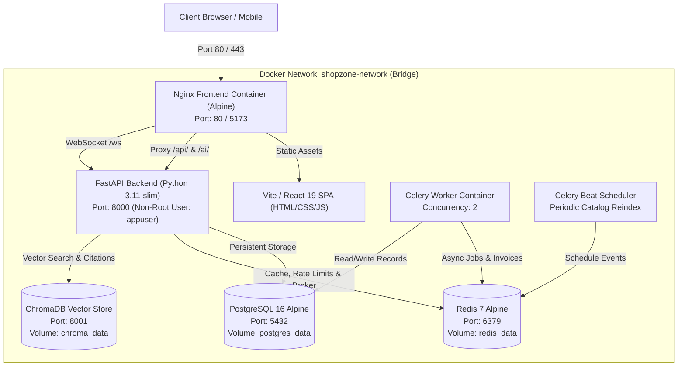
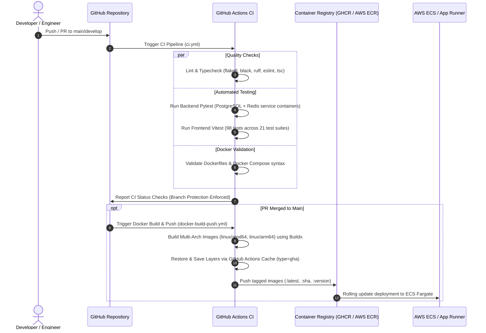

# Day 23 – DevOps / AWS Focus: Containerization, Orchestration & CI/CD Guide

Comprehensive architectural manual and evaluation guide for **ShopZone / GenZ Zone Day 23 DevOps Focus**.

---

## 1. System Architecture & Container Topology

---

## 2. CI/CD & Automated Deployment Pipeline

---

## 3. Curriculum Topics & Implementation Details

### Topic 1: Docker Fundamentals & Multi-Stage Builds
* **Backend (`Dockerfile.backend`)**:
  * **Stage 1 (`builder`)**: Uses `python:3.11-slim`, installs build tools (`build-essential`, `libpq-dev`), creates virtual environment at `/opt/venv`, and installs dependencies without caching wheels.
  * **Stage 2 (`runner`)**: Uses `python:3.11-slim`, installs only runtime shared libraries (`libpq5`, `curl`), copies `/opt/venv` from builder, creates an unprivileged user `appuser` (UID 1001), enables `HEALTHCHECK` with curl, and runs Uvicorn.
  * **Outcome**: Minimal image footprint, zero build tools in production image, and non-root security.
* **Frontend (`Dockerfile.frontend`)**:
  * **Stage 1 (`builder`)**: Uses `node:20-alpine`, runs `npm ci`, and compiles production static files into `dist/`.
  * **Stage 2 (`runner`)**: Uses `nginx:1.25-alpine`, copies custom `nginx.conf`, mounts production assets to `/usr/share/nginx/html`, and configures healthchecks.
  * **Outcome**: Ultra-fast static delivery (<25MB container size) with production Gzip compression.

### Topic 2: Docker Compose Multi-Service Orchestration
* Single-command execution: `docker compose up -d`.
* Orchestrates 7 services:
  1. `backend`: FastAPI API server with healthcheck.
  2. `frontend`: Nginx web server with reverse proxy.
  3. `postgres`: PostgreSQL 16 database with `pg_isready` healthcheck.
  4. `redis`: Redis 7 in-memory cache and Celery message broker.
  5. `celery_worker`: Background worker processing invoices and embeddings.
  6. `celery_beat`: Periodic scheduler executing catalog maintenance.
  7. `chromadb`: Persistent vector store for AI Shopping Assistant grounding.
* **Healthcheck Dependencies**: Containers use `depends_on: { <service>: { condition: service_healthy } }` preventing startup race conditions.

### Topic 3: Docker Networking & Persistent Volumes
* **Custom Bridge Network (`shopzone-network`)**: Enables DNS service discovery by container name (`postgres:5432`, `redis:6379`, `backend:8000`).
* **Named Persistent Volumes**:
  * `postgres_data`: Preserves database records across container restarts and updates.
  * `redis_data`: Preserves AOF/RDB cached keys and message queues.
  * `chroma_data`: Preserves vector index embeddings.
  * `app_logs` & `app_uploads`: Shared persistent storage for invoices and log output.

### Topic 4: GitHub Actions CI & Docker Build/Push
* **CI Pipeline (`.github/workflows/ci.yml`)**:
  * Runs linting (`black`, `flake8`, `eslint`, `tsc`).
  * Runs backend tests using real PostgreSQL 16 and Redis 7 service containers.
  * Runs frontend Vitest suite (98 tests across 21 test files).
  * Validates Docker Compose configuration.
* **Build & Push Pipeline (`.github/workflows/docker-build-push.yml`)**:
  * Multi-architecture emulation with QEMU (`linux/amd64`, `linux/arm64`).
  * Advanced Buildx caching (`type=gha`) for fast builds.
  * Image tagging with semantic versioning and Git commit SHA.
* **Branch Protection (`.github/workflows/branch-protection.yml`)**:
  * Enforces semantic PR title conventions.
  * Scans diffs to prevent accidental credential/secret leakage.

### Topic 5: Environment & Secrets Management
* Local environment: `.env.docker` with preconfigured development defaults.
* Production template: `.env.production.example` featuring:
  * AWS RDS Aurora connection strings with SSL mode enabled.
  * AWS ElastiCache TLS-enabled Redis strings.
  * Secure secret key placeholders for AWS Secrets Manager.
  * Production CORS domain fencing.

---

## 4. Product Color & Variant Consistency (Dresses & Jeans)

In accordance with product verification requirements:
* **Dresses & Kurtis**:
  * **Product ID 5 (`Elegant Velvet Evening Cocktail Maxi Dress`)**: Primary color is **Royal Amethyst Purple** (`#701a75`), showing the authentic purple velvet dress. Clicking swatches dynamically updates the image and all 3 multi-angle perspectives to Sky Blue, Festive Green, or Crimson Red.
  * **Product ID 8 (`Handloom Anarkali Printed Cotton Kurti Set`)**: Primary color is **Pastel Sky Blue** (`#38bdf8`), displaying the authentic blue printed kurti.
  * **Product ID 98 (`Women's Floral Summer A-Line Dress`)**: Mapped to **Blush Floral Rose** (`#e17f8a`), matching the soft floral summer dress image.
* **Denim Jeans & Bottomwear**:
  * **Product ID 7 (`Distressed Raw Edge Straight Leg Denim Jeans`)**: Primary color is **Classic Indigo Denim** (`#2563eb`), showing blue denim jeans.
  * Clicking **Midnight Washed Black** (`#18181b`) switches the view to black denim jeans.
  * Clicking **Vintage Light Washed Blue** (`#60a5fa`) switches to light washed vintage jeans.
  * **Result**: The color swatch clicked in the UI always displays the exact matching color image and attributes.

---

## 5. Evaluation / Viva Quick Reference

**Q1: Why do we use multi-stage Docker builds for FastAPI and React?**
* **Answer**: Multi-stage builds separate the build environment from the final runtime environment. For FastAPI, build dependencies like compilers and headers (`gcc`, `libpq-dev`) are isolated in the builder stage; only the compiled wheels and minimal runtime libraries (`libpq5`) are copied to the runner stage. For React, Node.js and `node_modules` (often >300MB) are kept in the build stage, and only the compiled HTML/CSS/JS (`dist/`) is copied into a lean Nginx Alpine container (<25MB). This dramatically reduces container attack surface, speeds up deployment pulls, and prevents build tools from leaking into production.

**Q2: How does Docker Compose ensure service startup ordering without crashes?**
* **Answer**: Traditional `depends_on` only waits for a container to start, not for the underlying daemon to be ready to accept TCP connections. We use healthchecks (`pg_isready` for Postgres, `redis-cli ping` for Redis, and `/health` for FastAPI) combined with `depends_on: { <service>: { condition: service_healthy } }`. This guarantees that FastAPI will never start before PostgreSQL is actively accepting queries.

**Q3: How do we manage secrets between Local Development, CI/CD, and AWS Production?**
* **Answer**: We never commit plain-text credentials to Git. For local development, we use `.env.docker`. In GitHub Actions CI, credentials are provided via GitHub Repository Secrets (`${{ secrets.GITHUB_TOKEN }}`). In AWS production, sensitive keys (database passwords, AI API keys, JWT secret keys) are stored in AWS Secrets Manager or AWS Systems Manager Parameter Store and injected directly into container environment variables at runtime via ECS task definitions or IAM roles.
